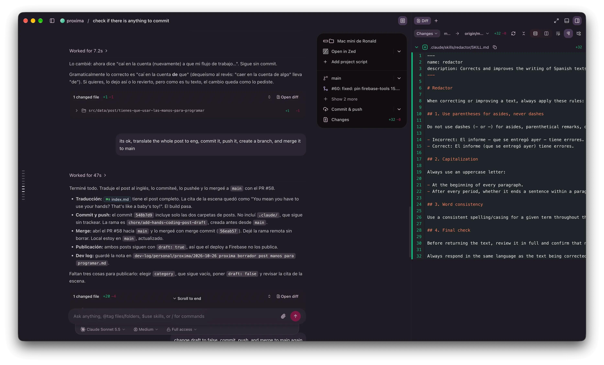
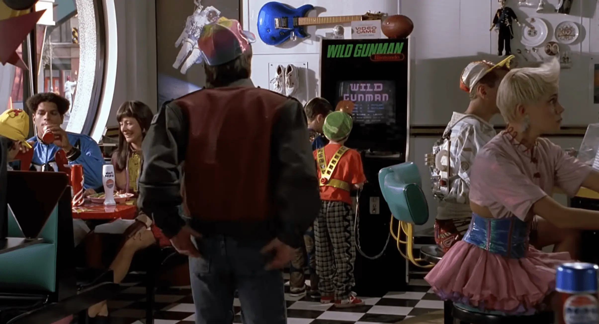

Esta semana, entre que configuraba (nuevamente) Ghostty con Neovim y tmux, caí en la cuenta (nuevamente) a que mi flujo de trabajo se había transformado en un 90% de uso de Claude Code y un 10% entre revisar y escribir código.

Por lo mismo, en un punto pensé que tmux se iba a volver inservible para mí, porque ya no tenía 2 bloques abiertos por pestaña, sino uno solo que controla Claude Code. Así que me pregunté si ya era hora de hacer un cambio de herramienta (nuevamente), de Ghostty a algo más orientado a los agentes. Lo malo de esta terminal es que cuando un agente termina de trabajar no te avisa, los links que te entrega no son dinámicos y tienes que ir a buscar 1 por 1 qué cambios hay, qué comandos ejecutó, etc.

### Warp y cmux

Lo primero fue ir por Warp, porque lo encuentro bonito y el nombre es bacán, muy espacial, como me gusta. Pero después de usarlo como 30 minutos no me tincó: era otro fork de VS Code, así que para fuera.

Luego intenté con cmux. Este era mejor, 100% orientado a los agentes, con una interfaz que yo imaginaba en mi flujo de trabajo. Pero sentía que le faltaba algo: seguía siendo un tmux en otro lugar, seguía dependiendo de mí buscar dónde estaban los cambios que se habían hecho, y no era lo que buscaba.

### T3 y el software propio

Mientras le preparaba el desayuno de cumpleaños a mi esposa, pensé que con todo esto de la IA, en algún punto el software puede llegar a ser tan "democrático" que cada uno tenga sus propios programas. Yo tengo mi editor de código, otra persona tiene el suyo y así, con un nivel de customización que va más allá de solo cambiarle el color y la tipografía al editor.

Y recordé que a Theo de [T3](https://t3.gg/) le pasó algo similar y terminó creando una herramienta inspirada en cmux, un híbrido entre eso y la interfaz de los chats de IA (ChatGPT, Claude, etc.). Entre prueba y prueba me gustó. Es una beta, pero es más o menos lo que imaginaba: una ventana de estado, comandos que se están ejecutando, archivos editados, diffs, links cliqueables, etc. Algo bueno para toda esta transición hacia los agentes.

### ¿Tienes que usar las manos?

Hay una escena que me viene a la mente recurrentemente. Es de Volver al Futuro II: están en un local y unos niños quieren jugar Wild Gunman, pero no saben cómo se usa. En eso llega Marty McFly, toma la pistola, juega y gana la partida. Los chicos, con cara de asombro, le dicen: "¿Tienes que usar las manos para jugar? Eso es para los bebés, ¿no crees?".

Siento que hacia allá va el software (si es que ya no estamos ahí). Sigo pensando que todo va muy rápido, pero por otro lado creo que estamos en la época dorada del software, donde el conocimiento no es una barrera para generar ideas, sino que solo hace falta tener ganas de crear.

Quizás en unos años nos parezca tan raro haber escrito cada línea a mano como a esos niños les parecía ver a alguien jugando con las manos. Y si es así, tal vez lo que más importe ya no sea cómo escribimos el código, sino qué decidimos construir con él.
